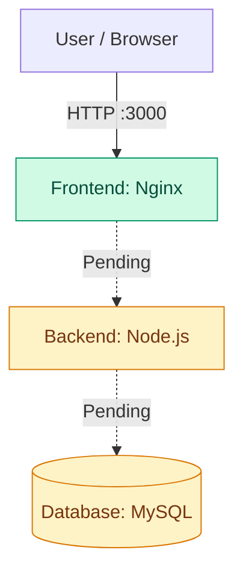
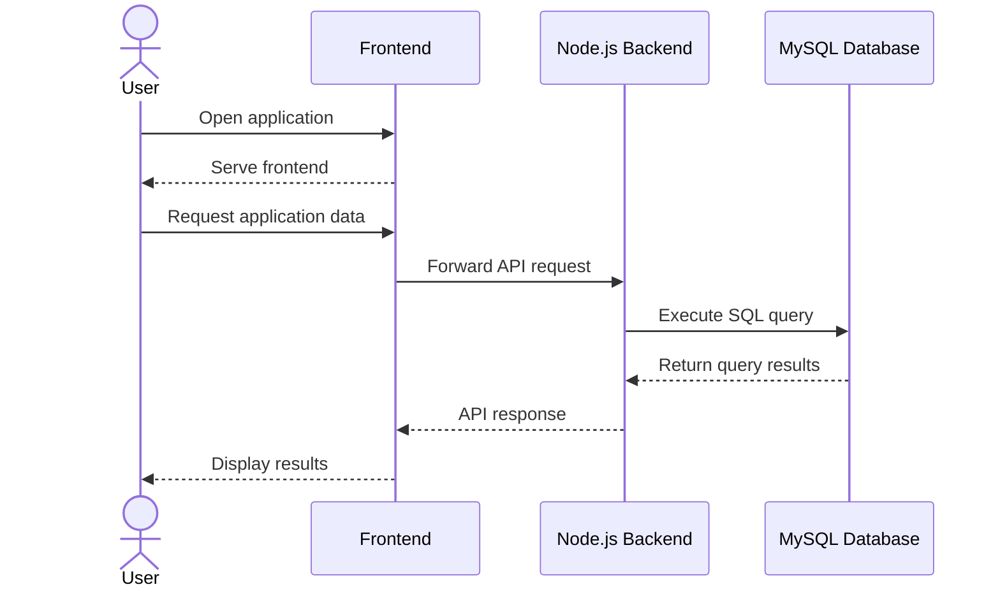

# 3-tier-architecture
# 🐳 Dockerized Three-Tier Application

A hands-on DevOps project demonstrating the development of a three-tier web application using Docker. The project is being built step by step, starting with a containerized Nginx frontend, followed by a Node.js application backend and a MySQL database.

## 🏗️ Project Architecture

### Current Status



**Legend**
- 🟢 Completed: Nginx frontend container
- 🟡 Pending: Node.js backend and MySQL database

## 📊 Project Progress

| Component | Technology | Status |
|---|---|---|
| Containerization | Docker | In use |
| Frontend | Nginx | Running |
| Frontend access | `localhost:3000` | Verified by current project notes |
| Application backend | Node.js | Pending |
| Database | MySQL | Pending |
| Multi-container orchestration | Docker Compose | Planned |
| Backend API integration | REST API | Pending |
| Database connectivity | Node.js + MySQL | Pending |
| Persistent database storage | Docker volumes | Planned |
| GitHub Actions CI/CD | GitHub Actions | Future improvement |
| Cloud deployment | AWS | Future improvement |

## 🛠️ Technology Stack

| Technology | Purpose |
|---|---|
| Docker | Containerize application components |
| Nginx | Serve the frontend web application |
| HTML, CSS, JavaScript | Build the frontend interface |
| Node.js | Planned backend application runtime |
| MySQL | Planned relational database |
| Docker Compose | Planned multi-container orchestration |
| Git & GitHub | Version control and project documentation |
| Linux / Windows PowerShell | Development and command-line operations |

## ✅ Completed Work

### 1. Docker Frontend Container

The Nginx frontend container has been created and started.

- **Container name:** `my-docker-app`
- **Container technology:** Nginx
- **Container port:** `80`
- **Host port:** `3000`
- **Access URL:** http://localhost:3000

The port mapping `3000:80` allows the browser to access the Nginx web server through port 3000 on the local machine.

### 2. Verify the Running Container

Run these commands in Windows PowerShell:

```powershell
docker ps
```

To inspect the frontend container:

```powershell
docker inspect my-docker-app
```

To view its logs:

```powershell
docker logs my-docker-app
```

To open the application in your browser:

```powershell
Start-Process http://localhost:3000
```

**Expected result:** The browser opens the frontend served by the Nginx container.

## 🚧 Work Remaining

### Phase 2: Application Tier — Node.js

**Status: Pending**

Planned tasks:

- Set up a Node.js backend application.
- Create REST API endpoints.
- Add a backend Dockerfile.
- Configure the backend to communicate with MySQL.
- Test the backend independently.

### Phase 3: Database Tier — MySQL

**Status: Pending**

Planned tasks:

- Configure a MySQL database container.
- Create the application database and tables.
- Configure database credentials through environment variables.
- Connect the Node.js backend to MySQL.
- Test Create, Read, Update, and Delete (CRUD) operations.
- Configure persistent storage using a Docker volume.

### Phase 4: Docker Compose

**Status: Pending**

Planned tasks:

- Create a `docker-compose.yml` file.
- Define the frontend, backend, and database services.
- Configure a dedicated Docker network.
- Set up service dependencies and health checks.
- Start and manage the application with Docker Compose.

The intended command for starting the complete application is:

```powershell
docker compose up --build -d
```

Run this after the Compose configuration and required application files have been created.

## 📁 Planned Project Structure

```text
docker-3-tier-app/
│
├── frontend/
│   ├── Dockerfile
│   ├── index.html
│   └── nginx.conf
│
├── backend/
│   ├── Dockerfile
│   ├── package.json
│   └── server.js
│
├── database/
│   └── init.sql
│
├── docker-compose.yml
├── .env.example
├── .gitignore
└── README.md
```

This is the target structure. Files and directories should be added as each phase is implemented.

## 🔄 Intended Request Flow

Once all three tiers are implemented, the expected request flow will be:

1. The user opens the application in a web browser.
2. Nginx serves the frontend.
3. The frontend sends API requests to the backend.
4. Node.js processes the requests.
5. The backend reads or updates records in MySQL.
6. MySQL returns the results to Node.js.
7. The backend sends a response to the frontend.



*This describes the planned architecture; backend and database communication have not yet been completed.*

## 🔐 Security Practices

The project will follow these practices as it develops:

- Store database credentials in a local `.env` file.
- Exclude `.env` and other secret files from Git using `.gitignore`.
- Provide `.env.example` without real passwords.
- Avoid exposing the MySQL port publicly.
- Use a dedicated Docker network for application services.
- Configure health checks and persistent database storage.
- Consider HTTPS, image vulnerability scanning, and backups before production deployment.

Never commit real passwords, access tokens, or other credentials to GitHub.

## 🗺️ Future Improvements

- [ ] Complete the Node.js backend.
- [ ] Configure the MySQL database.
- [ ] Integrate the frontend, backend, and database.
- [ ] Implement CRUD API operations.
- [ ] Orchestrate all services with Docker Compose.
- [ ] Add automated application and API tests.
- [ ] Publish container images to Docker Hub.
- [ ] Create a CI/CD pipeline using GitHub Actions.
- [ ] Deploy the application on AWS.
- [ ] Configure HTTPS, monitoring, and logging.
- [ ] Add screenshots of the running application and containers.

These items are planned improvements and are not claimed to be completed.

## 👨‍💻 Author

**Project:** Dockerized Three-Tier Application

**Focus:** Docker, containerization, web servers, backend development, database integration, networking, and DevOps fundamentals.

**GitHub:** https://github.com/ayeshajamil937-glitch

---

⭐ Built as a practical learning project to develop hands-on experience with Docker and three-tier application architecture.

**Project status:** In Progress — Nginx frontend running; Node.js backend and MySQL database pending.
